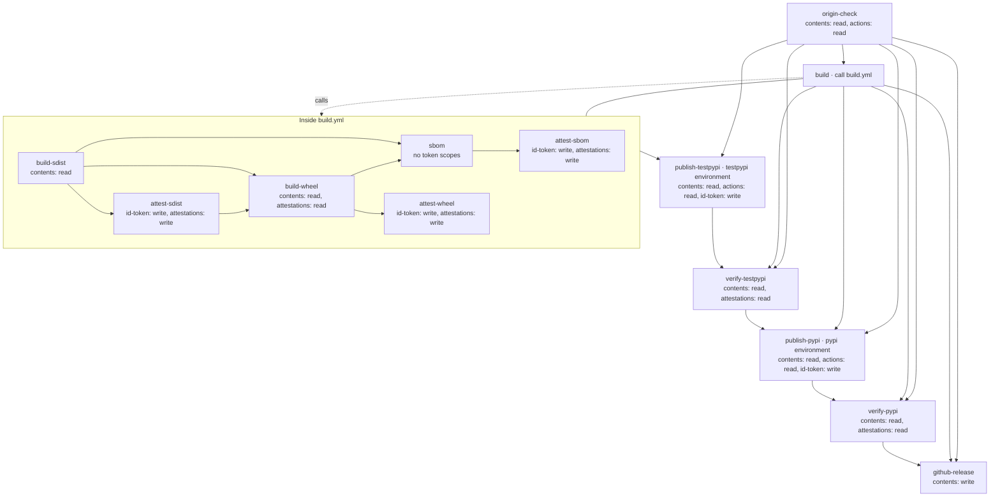
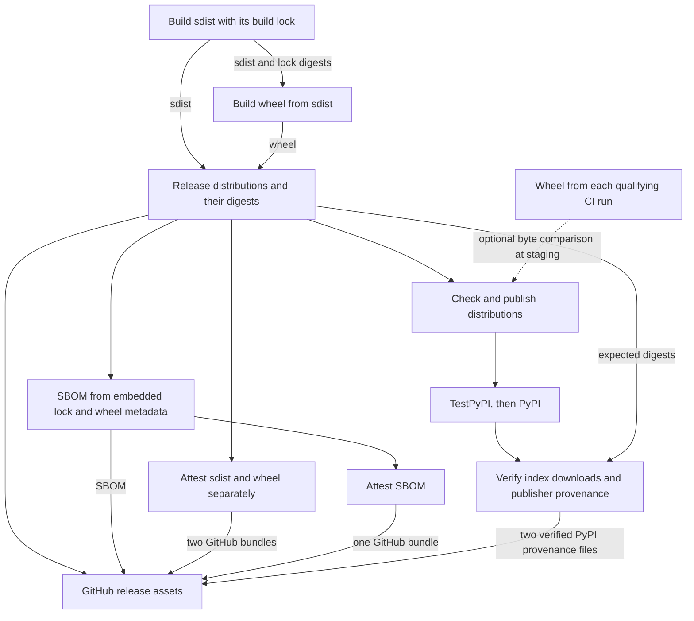
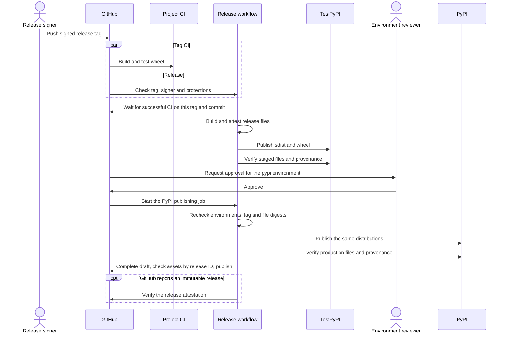

# How a release moves through the pipeline

A release signer pushes a signed tag such as `v1.2.0`. That starts two runs on GitHub Actions. The project's continuous integration (CI) workflow installs a wheel and runs the tests against it. The wheel is the distribution most users will install. The release workflow waits for CI, builds the distributions again, and stages them on TestPyPI. By the time a reviewer approves publication to PyPI, the release files already exist and the workflow has checked what TestPyPI serves. Approval authorises the upload of those same bytes.

## One tag, two builds

`origin-check` establishes what the signer authorised. It checks that the annotated tag names the expected version, points to the expected commit on the default branch, and carries a signature from a release signer. It checks each signer file against its digest in the repository variable `RELEASE_SIGNERS_SHA256` before it accepts a signature. It also checks the tag rules and the protections on both publishing environments. A repository administrator audits the ruleset bypass lists separately because the workflow token cannot see them.

The release waits for successful push runs with the tagged commit and tag name. Ordinary branch runs on the same commit do not count. A branch with the same name as the tag can also match because GitHub reports the name without the ref type. At least one must call the repository's own `build.yml`. The kit's CI calls it with attestation disabled, checks the wheel digest, installs the wheel and runs the project's tests with the source tree removed. The release calls the same builder with attestation enabled and passes the version from the tag.

Solid arrows show direct job dependencies in the release and inside the builder. The dotted arrow expands the reusable workflow call. Every job from staging onwards depends directly on both the origin check and the completed build. For example, the PyPI publisher takes the tag version from the first, the distribution names and hashes from the second, and permission to proceed from successful TestPyPI verification and human approval.

Both callers grant the builder a ceiling of `contents: read`, `id-token: write` and `attestations: write`. Each job inside it requests its own scopes, as shown above. Only the three attestation jobs can sign a statement about a build output. CI skips all three. Its separate test job runs with `permissions: {}`.

The separation matters when a build backend runs package code. Neither the backend nor the tools that inspect the package share a job with a publisher or a signer. The publishers use a short-lived OpenID Connect (OIDC) identity that each index recognises. Only the final GitHub release job can write repository contents. Even a job with no repository token scopes still has an Actions runtime token that can write artifacts and caches. This is why later jobs check the bytes they receive.

## How a file crosses a job boundary

An Actions artifact carries files between jobs. A job output carries a value separately through Actions, such as a SHA-256 digest, a fingerprint of a file's bytes. A consumer downloads the named file and hashes it against the expected value from the producing job. This detects a substituted file even if it arrives under the right name.

The diagram follows files rather than job dependencies. Only the release sdist (source distribution) and wheel go to the indexes. The GitHub release collects those files alongside the software bill of materials (SBOM), three signed build attestation bundles and two PyPI provenance files. The release job checks all eight assets against the digests from their producers.

The build lock lists exact build dependencies and their hashes. Under the default wheel-only resolution rule, the builder records the lock digest **before** it runs the backend. A fresh job takes the sdist as its only package source, checks its digest and release attestation, then extracts the lock and compares it with that earlier digest. Only then does it build the wheel. The sdist and wheel digests describe the *finished* files. They can detect a change in transit but cannot establish that the backend produced honest code.

Using the same builder twice does not guarantee that both wheels contain identical bytes. By default, the staging job downloads the wheel from each qualifying CI run and hashes it against the release wheel's digest. The CI copies stay outside the upload directory. A project that removes this optional comparison still requires green tag CI, but loses the link between the tested bytes and the published bytes.

## What approval authorises

The sequence shows the successful path. [Where a failed release stops](#where-a-failed-release-stops) describes what can already be public when a job fails. At each index, the verifier compares the digest from the build, the digest listed by the index and the hash of the downloaded file. GitHub's build attestation identifies the builder and source commit. The PEP 740 provenance identifies the publisher, including the repository, release workflow and environment. The verifier checks the signatures, installs the exact wheel from that index and resolves its dependencies from PyPI. CI already ran the project tests.

The reviewer can now base approval on a verified staging upload. A solo maintainer can act as both signer and reviewer. After approval, the production job rechecks the tag and environment protections because they could have changed during the wait. The final job preserves any notes in a prepared GitHub draft, or starts with an empty body. It reads the draft back by ID and checks the attached assets before making it public.

## Where a failed release stops

A failure stops dependent jobs. A staging failure can leave files on TestPyPI. Rejection at the approval gate leaves PyPI untouched and calls for a new tag. If a publishing job fails partway through an upload, a failed-job rerun checks each filename on that index. It skips a file whose digest already matches and uploads a missing file. A conflicting digest requires a new version and tag.

Once PyPI accepts a file, a later failure cannot retract it. If production verification fails, a maintainer handles the yank on PyPI. If only the GitHub release job fails, the distributions have already passed production verification. Its rerun checks the existing draft or published assets and repeats immutable-release verification when applicable.

The [workflow contracts](../reference/workflows.md) give the exact inputs, outputs and conditions. [Trust and limits](trust.md) explains what these checks establish about the published files.
