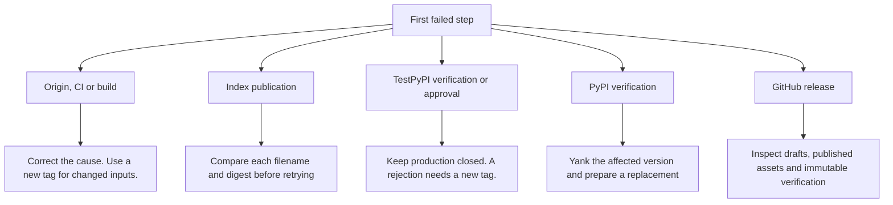

# Recover a failed release

Open the Actions run for the tag. Find the **first failed step** and read its error. Check which jobs already succeeded and which files are visible on the affected index. A red run can mean that nothing shipped, that one file shipped, or that the entire release is public.

On a narrow screen, scroll the diagram sideways to read its labels.

Follow the branch for the failed job. The package index and GitHub release have separate publication states. Fixing one cannot undo an upload to the other.

## Before production publication

| First failure | What can already be public | Operator action |
| --- | --- | --- |
| `origin-check` | Tag and CI run | Inspect the signature, current signer files, protections and tagged CI run. If CI timed out and later passed, rerun the failed job. If a setting drifted, have its owner restore and audit it first. An invalid tag or a commit that needs changing requires a fresh version and signed tag. |
| `build` | Tag, possibly build artifacts or GitHub attestations | Inspect the first failing builder step. For a packaging, version or lock error, correct the source, test the new commit and release a new version. |
| CI wheel comparison in `publish-testpypi` | No staging upload by this attempt | Compare the wheels for the same commit and tag. Inspect file contents, timestamps and version metadata. Correct the build or review the [optional comparison](adapt.md) if reproducibility is unattainable. Release workflow edits take effect on a new commit and tag. |
| `verify-testpypi` | One or both staging files | Inspect the exact failing filename, digest, publisher identity, signature or install step. A delayed listing can clear on a failed-job rerun. Incorrect bytes or missing provenance on an existing file require a fresh version. |
| Reviewer rejects `publish-pypi` | Verified staging release | Stop this release. Resolve the reason for rejection and use a new version and signed tag. |

## When an upload fails partway

Check the version on the index named by the failed publisher. For each expected wheel and sdist, compare the filename and index SHA-256 with the original build outputs.

| State on that index | What the publisher does on a rerun |
| --- | --- |
| Filename absent | Selects that file for upload. |
| Filename present, SHA-256 matches | Leaves the file in place. Verification still requires valid provenance for that file. |
| Filename present, SHA-256 differs | Stops. Investigate the conflict and choose a new version. |

For example, if a trusted publisher uploaded the correct sdist before the wheel upload failed, rerun the failed publisher in the original run. It uploads the missing wheel. Both files then go through verification. A manual upload of the same sdist can have the correct digest and lack the required publisher attestation. A rerun cannot add that missing provenance by skipping the file.

A failed lookup other than a version 404 stops publication. Restore service or access before retrying. The verifier waits for both filenames for about ten minutes, with sleeps of 5, 10, 20, 40 and 80 seconds, then 60 seconds. Its deadline check precedes each sleep. Use **Re-run failed jobs** in the Actions run when the original inputs are still valid. If the publishing job enters the production environment again, its reviewer must act on the new approval request.

## When PyPI verification fails

Treat the affected version as publicly installable. The failed verifier blocks the GitHub release. Ask the PyPI project owner to open **Manage project → Releases**, select the affected version and yank it with the reason. Confirm the version shows as yanked. Exact pins can still select it. Fix the cause, then publish a new version with a new signed tag. [PyPI yanking](https://docs.pypi.org/project-management/yanking/)

## When only the GitHub release fails

PyPI verification already succeeded. Inspect the release for the tag in GitHub, including drafts visible to a maintainer. Compare each attachment with the [expected names and digests](../reference/workflows.md#github-release-assets).

- **Draft conflict.** Identify the intended draft by its release ID and preserve its notes. Have its owner resolve duplicate drafts or unexpected assets after inspecting them. Rerun the failed job. It uploads to the draft, rechecks the tag and verifies the exact asset set by release ID before publishing.
- **Already published.** The job checks all eight assets. If an asset differs, is missing or is unexpected, inspect the job logs and the public asset list before taking further action. An immutable asset mismatch calls for a corrected release under a new tag. If the assets match, rerunning the final job leaves them in place.
- **Immutable verification timed out.** The release can already be public. Read the verification attempts and timestamps. Each job uses its own token throughout its 300-second window, including on a rerun. The workflow aims to start an attempt every ten seconds and limits each command to the time left. Rerun only the failed release job once the service is available. Success requires the workflow's own verification to pass. Repeated failure with matching assets is grounds to investigate GitHub availability or token access. A successful check under a personal credential does not clear the job.

For a local diagnosis of a single guard, use [Test a pipeline change](test.md). Keep the existing release tag at its original commit throughout recovery.
